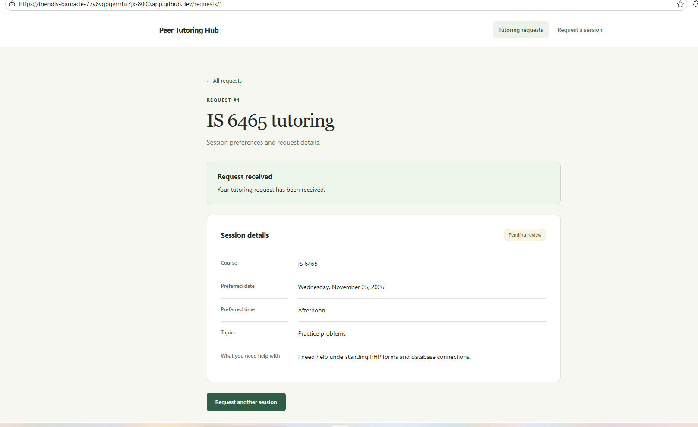

# Lab 8 — Laravel MVC Demo

## Part 2 — Explore MVC

### Question 1

The Peer Tutoring Hub allows students to request help with their courses. Students can select their course and topics, request a date and time, and provide a description of what they need help with. The application stores the requests so that they can be viewed later. 

### Question 2

One of the routes used by the application was 'POST /requests'. This route was defined in 'routes/web.php'. The route runs when a student completes the tutoring request form and selects "Request Session". Laravel then sends the submitted information to the store() method in TutoringRequestController for processing. 

### Question 3

The application uses 'TutoringRequestController.php' to manage sent tutoring requests. The controller displays the request form, validates the student's submitted information, saves all valid requests, and then displays them. This is seen when the store () function validates the submitted information and then redirects the user to the request details page after saving the request. 

### Question 4

One model used by the application is the TutoringRequest model. This model represents the information entered when a student submits a tutoring request. The data represents the course information, reason for requesting help, topics, and the data and time. Laravel uses the model to save and retrieve the tutoring requests from the SQLite database. 

### Question 5

One of the views used by the application is 'show.blade.php'. This displays the details of a submitted tutoring request. The user can then view confirmation that their request was sent and received before returning to the request list.

### Question 6

When a student fills in the request form and clicks "Request Session", the application uses the 'POST /requests' route in 'routes/web.php'. This then sends the information to the store() function in TutoringRequestController. This validates the information entered by the student. Once the request is validated, the TutoringRequest model saves the request to the SQLite database. The controller then redirects the student to the request details page, where the 'show.blade.php' view displays the saved information. 

### Question 7

Laravel organizes the application using routes, controllers, models, and views. Our previous coursework used separate PHP pages, services, and repositories to manage similar functions. A benefit of Laravel is its consistent structure, which makes the application easier to organize and maintain. We are not required to convert our project to Laravel, since we have already developed a working application using what has been taught previously.

## Part 3 — Evidence of Completion

### Running Laravel Application

The screenshot below shows the successful submission of an IS 6465 tutoring request in the Laravel application.

### MVC File Evidence

**Route — `app/routes/web.php`**

This file defines the URLs used by the application and connects them to the appropriate controller functions. For example, the `POST /requests` route calls the `store()` function when a tutoring request is submitted.

**Controller — `app/app/Http/Controllers/TutoringRequestController.php`**

This file manages tutoring requests by displaying forms, validating submitted information, saving requests through the model, and directing users to the appropriate pages.

**Model — `app/app/Models/TutoringRequest.php`**

This file represents the tutoring request information stored in SQLite, including the course, reason, topics, preferred date, and preferred time.

**View — `app/resources/views/requests/show.blade.php`**

This file displays the details of a saved tutoring request, including the selected course, date, time, topics, and confirmation message.

### Reflection

Laravel helped me understand how different parts of a web application work together. Laravel organizes the routes, controllers, models, and views into separate files, which is different from previous coursework, where we used PHP pages, services, and respositories. This makes it easier for the developer to understand where different functions are handled. This made it easier to follow a tutoring request from the form submission through the controller and database to the confirmation page. One thing that was new to me was how Laravel used models to interact with the database without having to write SQL queries for each operation. Throughout the assignment, it took some time to get used to this process, but exploring the files helped me better understand how MVC works. 
